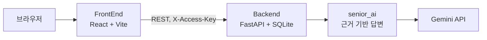

# 졸업하지 않는 선배 · FrontEnd

해마다 임원이 바뀌는 학생 조직의 기록을 기억하고, 새 임원에게 "작년 이맘때"를 먼저 알려 주는 AI 선배의 웹 화면입니다. (AI 우왕톤 TEAM 06)

- 배포: https://woowangthon-team-06-fe.vercel.app (접근 키 필요)
- 저장소: [FE](https://github.com/woowangthon/WOOWANGTHON_TEAM_06_FE) · [BE](https://github.com/woowangthon/WOOWANGTHON_TEAM_06_BE) · [AI](https://github.com/woowangthon/WOOWANGTHON_TEAM_06_AI)
- 배포 서버의 데이터는 직접 만든 **가상 데이터(가명)** 입니다.

## 화면

| 메뉴 | 내용 |
| --- | --- |
| 작년 이맘때 | 첫 화면. 오늘 기준 전년도 같은 시기의 행사 카드, AI 브리핑, 올해 결정 남기기(AI 초안은 제안만) |
| 선배에게 묻기 | 질문에 근거 기록과 인용 구절을 붙여 답변. 표는 표로, 근거를 누르면 원본 문서 확인 |
| 기록 | 문서(PDF·hwp·hwpx·docx·txt) 업로드, 검색·필터, 수정·삭제, 퇴임 인터뷰 |
| 결정 | 남긴 결정을 연도별로 모아 근거 문서와 함께 표시 |
| 지식 그래프 | 기수·행사·문서·교훈·결정의 연결 |

위쪽 검색창에서 문서 안의 표(타임테이블 등)를 바로 찾을 수 있습니다.

## 구조



프론트엔드는 백엔드 API만 호출합니다. 모델 키와 데이터는 모두 서버에만 있습니다.

## 기술 선택

- **React + Vite + TypeScript:** 화면이 다섯 개뿐이라 라우터와 상태 라이브러리 없이 가볍게 구성했습니다.
- **자체 CSS:** UI 라이브러리 없이 웹메일 느낌의 레이아웃과 원본 문서 같은 표 디자인을 직접 만들었습니다.
- **접근 키:** 로그인 대신 키 하나로 접속을 제한합니다. 입력한 키는 브라우저에만 저장하고 모든 요청의 `X-Access-Key` 헤더로 보냅니다.
- **AI 답변 표시 원칙:** 모든 답변에 근거 기록과 인용 구절을 붙이고, 검색된 구간 수를 보여 줍니다. AI는 초안만 제안하고 저장은 사람이 합니다.

## 실행

```bash
npm install
cp .env.example .env.local   # VITE_API_BASE = 백엔드 주소 (기본 http://localhost:8000)
npm run dev                  # http://localhost:5173
npm run build                # dist/ 생성
```

백엔드 실행 방법은 [BE 저장소 README](https://github.com/woowangthon/WOOWANGTHON_TEAM_06_BE)를 참고합니다.

## 배포 (Vercel)

1. Vercel에서 이 저장소를 가져옵니다(프레임워크 Vite).
2. 환경 변수 `VITE_API_BASE`에 백엔드(Render) 주소를 넣습니다.
3. 백엔드의 `CORS_ORIGINS`에 이 사이트 주소를 넣어야 호출이 허용됩니다.
